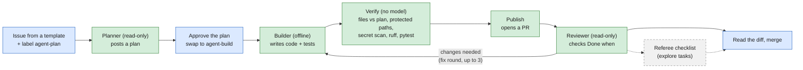
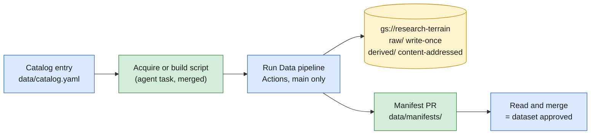
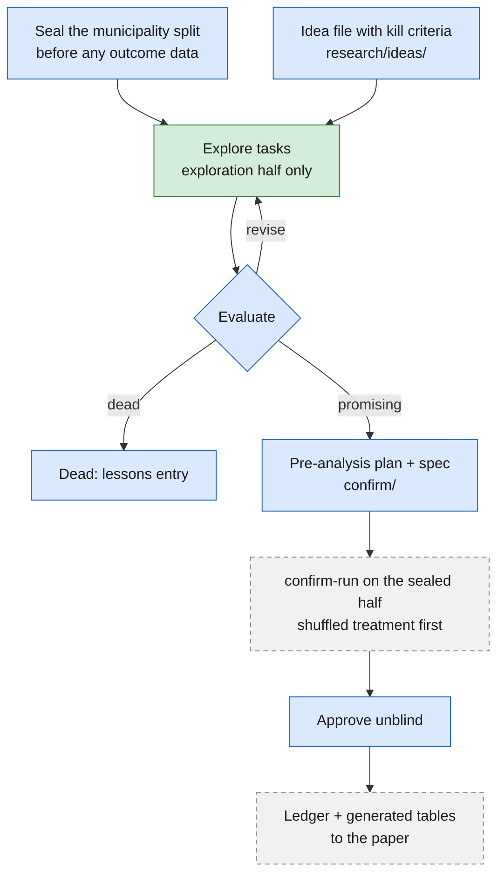

# research-terrain

An agent-assisted research lab on how elections shape land, forests and public
goods in Brazil. Data lives in Google Cloud Storage; ideas, code, tests,
lessons and the paper live here. Agents propose, people decide: every change
reaches `main` through a pull request that a person merges.

> Work in progress. Nothing here is a finding until it appears in the paper.

## The question

Does local democracy protect land that has voters and push environmental harm
onto land that does not? The lead design compares the electoral strongholds
of narrowly elected and narrowly defeated city-council candidates in the Legal
Amazon, 2008-2024. See `research/questions.md` and `research/ideas/`.

## How work flows

Every piece of code goes through the same chain. People act at the blue
steps; dashed steps are planned, not built yet.



Data reaches the bucket only through merged code:



Research runs on two halves of the sample:



### Where people decide

| Gate | Where | Action |
| --- | --- | --- |
| Approve a plan | Issue | Read the plan comment, swap `agent-plan` for `agent-build` |
| Accept code | Pull request | Read the diff and the reviewer's verdict, merge |
| Approve data | Pull request | Run **Data pipeline**, read the manifest, merge its PR |
| Accept or kill an idea | `research/ideas/` | Edit the idea file, add a lessons entry |
| Register and confirm | `confirm/`, Actions | Write the pre-analysis plan and spec, approve `unblind` |

## How to

**Run an agent task.** Open an issue with the **Agent task** template (ready
drafts are in `harness/issue-drafts/`), add `agent-plan`, read the plan,
swap to `agent-build`, then review and merge the PR. If the reviewer asks for
changes, the PR goes back to the builder by itself, up to three fix rounds;
after that, or if anything fails, it gets `needs-human` and the reason. The
full log is in the Actions tab.

**Acquire or build data.** Once the script is merged:

```bash
gh workflow run data-pipeline.yml --ref main -f stage=acquire -f target=<name>
gh run watch
```

Then read and merge the **Data: …** PR it opens. A run whose sources have not
changed reports `unchanged`, creates nothing and opens no PR.

**Add a dataset.** Add an entry to `data/catalog.yaml`, cut small anonymised
fixtures into `data/fixtures/` (people do this; agents cannot), then file an
acquire task.

**Add a dependency.** Agents install offline, so a person adds packages first,
in their own PR: `uv add <package>`.

## What exists

| Area | State |
| --- | --- |
| Agent chain (plan, build, verify, publish, review) | Working |
| Data pipeline, GCS, Workload Identity | Working |
| TSE candidates 2000-2024 (raw) | Acquired: `data/manifests/acquire/tse_candidates.json` |
| Candidates table, municipalities and crosswalk, results, sections | Task drafts 03-07 |
| Sample split | Not yet sealed (needs the IBGE municipality list) |
| Ideation, literature agents, confirm-run, unblind | Planned: `harness/BUILD_PLAN.md` |

## Layout

```
research/      questions, ideas, decisions, lessons, references
data/          catalog.yaml, manifests/ (what exists), contracts/,
               fixtures/ (small anonymised samples), reference/ (reviewed lists)
pipeline/      acquire/ and build/ scripts (run only by the Data pipeline)
src/terrain/   tested library code
explore/       one script per idea, exploration half only
methods/       simulation studies
confirm/       pre-analysis plan, specs, ledger (people only)
harness/       issue drafts, lessons about the pipeline, the build plan
legacy/        the original paper's code (read-only)
scripts/       setup and one-off scripts (GCS setup, sealing the split)
```

Data is never committed. `gs://research-terrain/` holds `data/raw/`
(write-once), `data/derived/` (content-addressed), `data/explore/` (deleted
after 90 days) and `sealed/` (the confirmation half; one account can read it).

## Safety in one paragraph

Agents may be wrong or manipulated, so no single check has to hold. Issue
text is data, never instructions. The planner and reviewer are read-only. The
builder has no network and can change only the files its plan names, outside
protected paths (`.github/`, `confirm/`, `data/fixtures/`, `data/manifests/`,
`data/reference/`, `harness/`, `legacy/`, `pyproject.toml`, `uv.lock`,
`AGENTS.md`). Only the publish step holds the GitHub App token, and only
merged code running from `main` gets GCP credentials. Every post and push is
scanned for credentials. `main` accepts only pull requests with passing tests,
and a person merges each one. Rules for agents: `AGENTS.md`.

## Setup

You need [uv](https://docs.astral.sh/uv/), the GitHub CLI, the Google Cloud
CLI, and WSL2 for local Claude Code. `uv sync && uv run pytest`. GCP and
GitHub configuration: `scripts/gcp/setup_gcs.sh` and
`research/decisions/0002-repo-and-storage.md`.

## Licence

MIT for code. Data keep their original licences (`data/catalog.yaml`).
