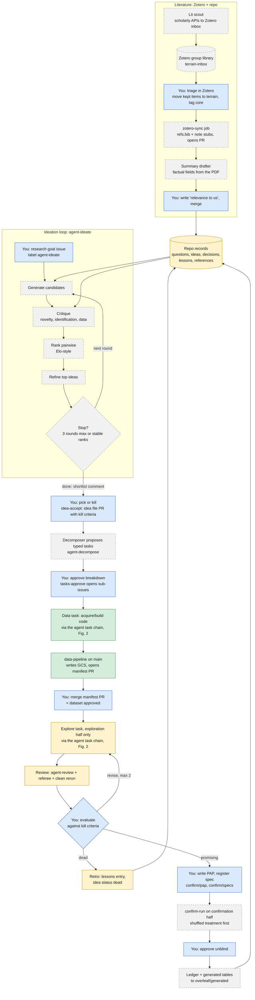

# research-terrain: agent research workflow, current state and build plan

> **Status note (2 November 2026, after `5b25d60`).** Phase 0.1 is done:
> `data/manifests/acquire/tse_candidates.json` is on `main`. Phase 1 is now
> broken into issue drafts 03-07 in `harness/issue-drafts/` (candidates,
> catalog-driven acquirer, municipalities and crosswalk, results, sections
> and polling places). Data profiling limits the stronghold design to the
> 2008-2024 elections, and the crosswalk comes from Hidalgo's pairs, not a
> community table: see `research/lessons.md`. The stray `package.json` is
> still present.

This document is a brief for an agent helping to build the research workflow for `gabrielsgaspar/research-terrain`. It describes:

- the workflow that has been settled on;
- what already exists in the repository;
- what still needs to be built, in order.

Snapshot: `main` at commit `5b25d60` (2 November 2026). Issue and PR states were not checked, so confirm open issues with `gh issue list` before starting.

---

## 0. How to use this document (for the building agent)

1. **Read `AGENTS.md` and `CLAUDE.md` in the repo first.** They are the rule set, and this document does not override them.
2. **Work on a branch and open a PR. Never push to `main`, never merge.** Gabriel reviews and merges everything.
3. **Know which paths are protected.** The `agent-build` verify step blocks pipeline agents from these paths, so changes there are built by a person (or by Claude Code locally with Gabriel driving), one PR per change:
   - `.github/`, `.claude/`, `harness/`, `legacy/`
   - `confirm/pap/`, `confirm/specs/`, `confirm/ledger/`, `confirm/split.sha256`
   - `data/fixtures/`, `data/manifests/`
   - `pyproject.toml`, `uv.lock`, `AGENTS.md`, `CLAUDE.md`
4. **Send everything else through the existing pipeline when possible.** That means an issue from the Agent task template, then `agent-plan`, then `agent-build`. This includes scripts, `src/terrain/`, tests and schemas, and doing it this way tests the pipeline on real work.
5. **Never add dependencies inside a task.** A person adds a package in its own PR (`uv add <pkg>`) before the task that needs it.
6. **Keep secrets out of everything.** Never write credentials or credential prefixes anywhere, including plans, checks and grep commands (see `AGENTS.md` › Secrets).
7. **Prefer extending what exists over adding parallel structures.** For example, extend `research/references/` rather than creating a new `lit/` folder, and make `agent-build.yml` aware of task type rather than writing a second builder.

---

## 1. Principles the workflow rests on

- **The repo is the memory.** Ideas, decisions, lessons, questions and references live as versioned, reviewed files. Agents read them before acting and propose updates through PRs. No hidden agent memory decides anything.
- **Humans decide, agents propose.** Every stage ends in a human gate: a label, a merge or an approval.
- **Explore freely, confirm once.** Municipalities are split into an exploration half and a sealed confirmation half (`research/decisions/0001-split-sample.md`). Agents explore on the first half. A surviving idea is registered (pre-analysis plan plus spec) and run once on the confirmation half.
- **Least privilege per stage:**
  - The planner and reviewer are read-only.
  - The builder has no network, installs offline, and can only change the files its plan names.
  - Only `publish` holds the GitHub App token.
  - Only merged code on `main` gets GCP credentials, through Workload Identity Federation (WIF) and environments.
- **Dead ends are results.** Every exploration updates its idea file and adds an entry to `research/lessons.md`, whatever the outcome.
- **Literature is curated, not scraped.** Zotero holds metadata and PDFs; the repo holds structured notes. Agents only ever read the repo's notes.

---

## 2. The settled workflow

### 2.1 Overview

Colour key: green = built, amber = partly built, grey dashed = to build, blue = human gate.



### 2.2 The agent task chain (already built)

Every data, explore or infrastructure task goes through this chain.

```mermaid
flowchart LR
  classDef built fill:#d4edda,stroke:#2e7d32,color:#1b1b1b
  classDef human fill:#dbe9ff,stroke:#1f5fbf,color:#1b1b1b
  classDef todo fill:#f1f1f1,stroke:#888,stroke-dasharray:5 4,color:#1b1b1b

  T0["You: issue from Agent task template<br/>add agent-plan"]:::human
  T1["agent-plan, Opus<br/>read-only, posts plan comment"]:::built
  T2["You: approve plan<br/>swap to agent-build"]:::human
  T3["build, Sonnet<br/>offline, allowlisted commands"]:::built
  T4["verify<br/>paths vs plan, protected paths,<br/>secret scan, ruff, pytest"]:::built
  T5["publish<br/>App token, opens PR on agent/ branch"]:::built
  T6["CI<br/>ruff + pytest"]:::built
  T7["agent-review, Opus<br/>Done-when verdict, label"]:::built
  T7b["referee checks<br/>econometrics checklist"]:::todo
  T8["You: read diff, merge"]:::human
  T0 --> T1 --> T2 --> T3 --> T4 --> T5 --> T6 --> T7 --> T8
  T7 -.-> T7b -.-> T8
  T3 -. "on failure" .-> R["report: needs-human"]:::built
```



### 2.3 Human gates, in one list

| # | Gate | Where | Action |
|---|---|---|---|
| 1 | Literature triage | Zotero | Move kept items from `terrain-inbox` to `terrain`, tag `core` |
| 2 | Literature notes | GitHub PR | Write "relevance to us", merge the note PR |
| 3 | Research goal | GitHub issue | Open the goal issue, add `agent-ideate` |
| 4 | Pick an idea | GitHub issue/PR | Add `idea-accept`, edit kill criteria, merge the idea-file PR |
| 5 | Approve tasks | GitHub issue | Edit the decomposer's proposal, add `tasks-approve` |
| 6 | Each task | GitHub | `agent-plan`, then `agent-build`, then merge (built) |
| 7 | Data approval | GitHub PR | Run `data-pipeline`, read the manifest, merge the manifest PR (built) |
| 8 | Evaluate exploration | GitHub PR | Merge, revise (max 2), or `kill` |
| 9 | Register and confirm | `confirm/`, Actions | Write the PAP and spec, approve `unblind` |

---

## 3. What exists today (`main` at `5b25d60`)

### 3.1 Built and working

**Agent task chain**

| Component | Location | Notes |
|---|---|---|
| Planner | `.github/workflows/agent-plan.yml` | Opus (`claude-opus-5-5`). Read-only tools. Write-access guard on the label. Posts a markdown plan with **Files to change** and **Done when** sections. |
| Builder | `.github/workflows/agent-build.yml` | Sonnet (`claude-sonnet-5-5`). `UV_OFFLINE=1`. Allowlisted Bash, no web tools. Jobs: build → verify → publish → report (`needs-human`). Verify enforces the plan's file list, protected paths, the secret-prefix scan, submodule rules, ruff and pytest. Publishing with the `terrain-agent` App works: PRs #2, #10 and #14 came from `agent/` branches. |
| Reviewer | `.github/workflows/agent-review.yml` | Opus. Runs on `workflow_run` after CI on `agent/**` branches. The `review` job is read-only; the `post` job writes one comment and one label (`agent-approved` or `needs-human`). |
| CI | `.github/workflows/ci.yml` | Actions pinned by SHA, `enable-cache: false`, `persist-credentials: false`, then ruff, format check and pytest. |

**Data infrastructure**

| Component | Location | Notes |
|---|---|---|
| Data pipeline | `.github/workflows/data-pipeline.yml` | Manual dispatch, `main` only, `data-write` environment, WIF. Runs `pipeline/<stage>/<target>.py`, then a separate job with the App token opens a PR adding `data/manifests/<stage>/<target>.json`. |
| GCS smoke test | `.github/workflows/gcs-smoke.yml` | Checks the IAM prefix rules. |
| GCS setup | `scripts/gcp/setup_gcs.sh` | One bucket with `data/raw/` (write-once), `data/derived/` (content-addressed), `data/explore/` (90-day lifecycle) and `sealed/`. One service account per role. |
| Python core | `src/terrain/` | `storage.py`, `manifest.py`, `catalog.py`, `split.py`, `sources/tse.py`, all with tests. |
| First acquire script | `pipeline/acquire/tse_candidates.py` | Merged (PR #14). |
| Repo rules tests | `tests/test_repo_rules.py` | Fails if a data file is committed outside `data/fixtures/`. |
| Fixtures | `data/fixtures/tse/` | TSE candidate samples for 2000–2024, plus a README of pitfalls. |
| Dataset registry | `data/catalog.yaml` | All entries currently `planned`: IBGE Legal Amazon list, TSE votes by section, TSE candidates (+ complementar), Hidalgo geocodes, MapBiomas, … |

**Research notebook and conventions**

| Component | Location | Notes |
|---|---|---|
| Ideas | `research/ideas/` | `0001-electoral-strongholds.md` (proposed), `0002-indigenous-councilors.md` (dead as a standalone design), `TEMPLATE.md`, and a `README.md` index table. |
| Decisions | `research/decisions/` | `0001-split-sample.md`, `0002-repo-and-storage.md` (ADR style). |
| Lessons | `research/lessons.md` | Dated log, newest first, in a fixed format. |
| Questions | `research/questions.md` | Core question, sub-questions, and what would change the plan. |
| References | `research/references/README.md` | Reading list only; no per-paper notes yet. |
| Confirmation scaffold | `confirm/` | `README.md`, `pap/README.md` (PAP outline), `specs/TEMPLATE.yaml`, empty `ledger/`. Human-only. |
| Other folder rules | `explore/README.md`, `methods/README.md`, `pipeline/README.md` | Pipeline script contract, exploration rules, methods notes. |
| Issue templates | `.github/ISSUE_TEMPLATE/` | `agent-task.md`, `idea.md`. |
| Labels | `scripts/create_labels.sh` | `agent-plan`, `agent-build`, `needs-human`, `agent-approved`, `idea`, `data`, `explore`. |
| Issue drafts | `harness/issue-drafts/` | 01 storage and manifests (done), 02 acquire TSE candidates (done), 03 build TSE candidates (next). |

### 3.2 Not built yet, or gaps

**Data and confirmation**
- **`data/manifests/` does not exist.** The TSE candidates acquire has been merged but either hasn't run through `data-pipeline` or its manifest PR hasn't been merged.
- **The split is not sealed.** `confirm/split.sha256` is missing because the IBGE municipality list hasn't been acquired. This must happen before any outcome data is merged with treatment.
- **`confirm-run` and `unblind` workflows don't exist.** No PAP has been written yet, which is correct at this stage.

**Paper and legacy**
- **No `overleaf/` submodule yet.** `.gitmodules` is absent.
- **`legacy/` holds only its README.** The original paper's code has not been imported.

**Agent pipeline**
- **The prompts live inline in the workflow files.** `harness/README.md` says they should move to `harness/` once they grow.
- **Plan parsing depends on formatting.** Verify and review extract **Files to change** with a regex over markdown headers, which is fragile.
- **Nothing exists yet for** Zotero, per-paper reference notes, record validation, ideation, the decomposer, the retro job, the referee checklist or the literature agents.

**Housekeeping**
- **A stray `package.json`** declares `uv` as an npm dependency. It is probably accidental; confirm with Gabriel and remove it.

---

## 4. Target design, component by component

### 4.1 Repo records (the knowledge layer)

Keep the existing files and conventions, and add light structure so agents can filter and validate them.

| Record | Location | Change |
|---|---|---|
| Ideas | `research/ideas/NNNN-slug.md` | Add YAML front matter: `id`, `title`, `status` (proposed, exploring, promising, dead, registered, confirmed, rejected), `updated`, `links`. Add a `## Kill criteria` section to `TEMPLATE.md`. Generate `README.md`'s table from the front matter. |
| Decisions | `research/decisions/NNNN-slug.md` | Add front matter: `id`, `date`, `status` (accepted or superseded), `supersedes`. |
| Lessons | `research/lessons.md` | Keep the single dated log. Optionally add an `(idea NNNN)` tag requirement so lessons can be indexed per idea. |
| Questions | `research/questions.md` | Keep as is. |
| References | `research/references/<citekey>.md` | New per-paper notes (§4.2). Rename the reading list to `README.md` › "To read". |
| Literature maps | `research/references/maps/<strand>.md` | One per strand: close elections under open-list PR, indigenous representation, political economy of deforestation, LLM measurement. Each has a comparison table. |
| Search log | `research/references/searches.md` | Dated queries, databases and inclusion rules. |
| Index | `research/INDEX.md` | Generated by `scripts/build_index.py`. Lists every record with its status, and is read first by every agent. |

**Validation:** `scripts/validate_records.py` plus a test in `tests/` checks the front matter and links. Because it runs under pytest, CI enforces it.

**Exploration results:** recorded in the idea file's `## Log` and in `lessons.md`, with outputs in `gs://research-terrain/data/explore/NNNN/`. Confirmation results go to `confirm/ledger/`. A separate results registry is not needed.

### 4.2 Literature with Zotero

**Ownership** (each field has exactly one home):

| Zotero owns | The repo owns |
|---|---|
| Bibliographic metadata, DOI | Structured summary |
| PDFs, highlights | "Relevance to us" |
| Status tags: `inbox`, `core`, `read` | Strand maps, search log |
| Role tags: `closest`, `adjacent`, `method` | Links to ideas and questions |
| Strand collections | Generated `refs.bib` |

**Zotero setup:**
- Two group libraries: `terrain` (curated) and `terrain-inbox` (the scout's landing zone). Zotero API keys are scoped per library, not per collection, so the scout's write key covers `terrain-inbox` only.
- Install the Better BibTeX plugin and pin citation keys before the first sync. Keys must never change, because file names and the paper depend on them.
- PDFs stay in Zotero storage (paid plan or WebDAV) and never enter Git. The repo is public.

**Per-paper note template**, `research/references/<citekey>.md`:

```markdown
---
citekey: fiva2016local
doi: 10.xxxx/xxxxx
zotero_key: ABCD1234
status: core            # core | read | skimmed
role: closest           # closest | adjacent | method
strands: [close-elections-openlist]
links: [research/ideas/0001-electoral-strongholds.md]
---
## Question            <!-- agent-drafted, confirm -->
## Setting and data    <!-- agent-drafted, confirm -->
## Identification      <!-- agent-drafted, confirm -->
## Main result         <!-- agent-drafted, confirm; include magnitudes -->
## What it doesn't do  <!-- Gabriel -->
## Relevance to us     <!-- Gabriel: what we borrow, how we differ -->
```

**The `.bib` file:** decision 0002 says `refs.bib` lives in Overleaf, but the sync job will generate it. **Proposed:** generate `research/references/refs.bib` in this repo and deliver it to `overleaf/generated/refs.bib` through the same route as other generated files. **Open decision:** Gabriel needs to confirm this (§6).

### 4.3 Ideation loop (`agent-ideate`)

- **Trigger:** the `agent-ideate` label on an issue from a new `ideation.md` template. The template asks for the goal, constraints, what is off-limits and the number of rounds (default 2, maximum 3).
- **Reads:** `research/INDEX.md`, `questions.md`, `ideas/`, `decisions/`, `lessons.md`, `references/`.
- **Rounds:**
  1. Generate about 6–8 candidates.
  2. Critique each one for novelty against `references/`, identification threats, data feasibility against `catalog.yaml`, and conflicts with `lessons.md` and `decisions/`.
  3. Rank by pairwise comparison (Elo-style). Optionally add one judge from a different model provider for diversity.
  4. Refine the top 3.
  5. Stop at the round cap or when the top-3 ranking stops changing.
- **Outputs:**
  - A shortlist comment on the issue. For each idea: claim, design, identification, data needed, main threats, nearest papers, rank rationale.
  - A PR adding the run log to `research/ideation/<issue>/`.
  - A "literature gaps" list as a scout request (§4.6).
- **Safety:** same pattern as `agent-plan`. The model step is read-only, and a separate no-model step posts the comment and opens the PR with the App token.
- **Acceptance:** Gabriel adds `idea-accept` and names the idea. A job opens a PR that:
  - creates `research/ideas/NNNN-slug.md` with kill criteria;
  - adds `lessons.md` entries for the losing ideas.

  Merging that PR is the acceptance.

### 4.4 Decomposer (`agent-decompose`)

- **Trigger:** the `agent-decompose` label on the goal issue, after the idea file has merged.
- **Behaviour:** reads the idea file, `catalog.yaml` and `data/manifests/`, then posts a proposed breakdown as a comment. Typed tasks:
  - `data`: an acquire or build script for one dataset.
  - `explore`: one analysis on the exploration half.
  - `methods`: a simulation or estimator.
- **Approval:** Gabriel edits the proposal and adds `tasks-approve`. A no-model step then opens sub-issues from typed templates, linked as GitHub sub-issues, with explore tasks marked as blocked by their data tasks. The decomposer never opens issues on its own.

### 4.5 Making tasks type-aware

- **Templates:** add `task-data.md` and `task-explore.md` to `.github/ISSUE_TEMPLATE/`, alongside the generic `agent-task.md`.
  - `task-data.md` prefills the `pipeline/README.md` contract, the catalog entry, and the requirement to add fixtures (people cut fixtures; the agent writes tests against them).
  - `task-explore.md` prefills the exploration-half rule, `explore/NNNN_slug.py`, the idea-file update and the lessons entry.
- **Builder:** keep one builder. The type can drive the allowed-path prefixes in verify, for example `explore/` and `src/terrain/` for explore tasks. The no-network, offline rule stays the same for every type: data tasks write code, and only `data-pipeline` touches GCS.
- **Referee:** extend the `agent-review.yml` prompt (or add a second review step) with an econometrics checklist that runs when the label is `explore` or `methods`. Checklist:
  - density test at the cutoff;
  - covariate balance;
  - bandwidth sensitivity;
  - placebo cutoffs and the pre-period placebo;
  - clustering at the municipality;
  - exploration-half-only reads;
  - consistency with `decisions/`.
- **Clean rerun:** a CI job reruns the exploration script on fixtures to confirm the outputs regenerate.
- **Revise cap:** the `agent-build` guard counts prior builds on the issue and refuses a third revision. It applies `needs-human` instead.

### 4.6 Literature agents

- **`zotero-sync.yml`:** runs on a schedule plus manual dispatch. It is a script, not a model.
  - Reads the `terrain` library with a read-only key and regenerates `refs.bib`.
  - Creates a stub `research/references/<citekey>.md` for each newly `core`-tagged item.
  - Opens a PR with the App token in a separate job.
- **`lit-draft.yml`:** triggered on stub PRs or by label. In an ephemeral job it fetches the PDF through the Zotero API, and a model fills only the four agent-drafted headings. Agent-drafted text is marked as such. PDFs are never committed.
- **`lit-scout.yml`:** runs on a schedule or on ideation gap requests.
  - Network limited to the scholarly APIs: OpenAlex, Semantic Scholar, Crossref.
  - Verifies each DOI and adds items to `terrain-inbox` with a "why suggested" note.
  - Holds the only Zotero write key and no GitHub write token.
  - Logs its queries to `searches.md` through a PR.
- **Coverage gap:** Brazilian and Portuguese-language work (SciELO, items without DOIs) is weakly covered by these APIs. Gabriel curates that part by hand.

### 4.7 Retro on kill

- **Trigger:** the `kill` label on an explore PR or issue.
- **Behaviour:** a job drafts a `lessons.md` entry (tried, result, why, implication) and sets the idea's status to `dead`, then opens a PR. Gabriel edits and merges it.

### 4.8 Confirmation

These pieces are human-heavy, and the existing design in `confirm/README.md` is followed as written.

- **`confirm-run.yml`:** manual, `main` only, environment `analysis`. Runs one registered spec from `confirm/specs/` on the confirmation half with **shuffled treatment**, and appends to `confirm/ledger/`.
- **`unblind.yml`:** manual, environment `unblind` (required reviewer: Gabriel). Reruns with the real treatment. Anything run afterwards is labelled post-unblinding.
- **Generated outputs:** tables and numbers go to `overleaf/generated/`. Numbers in the paper are never typed by hand.

### 4.9 Out of scope for now

- **Hermes Agent (Nous Research):** not part of the core pipeline. Its self-improving memory conflicts with "the repo is the memory". It could be revisited later as an outside-repo brainstorm sandbox or a literature scout, but only after Phase 3 and judged against a scorecard.
- **Autonomous merging or self-modifying prompts:** never.

---

## 5. Build sequence

Each phase must move the paper forward, not only the infrastructure. Phases 0–3 deliver most of the value. If time is short (the PhD finishes in December 2026), stop after Phase 3 and do ideation and literature scouting by hand.

### Phase 0: Finish the foundation

| # | Item | Who | Done when |
|---|---|---|---|
| 0.1 | Run `data-pipeline` acquire `tse_candidates`; merge the manifest PR | Gabriel | `data/manifests/acquire/tse_candidates.json` is on `main` |
| 0.2 | Make the planner emit a fenced `files_to_change` JSON block. Make verify and review parse that block instead of the header regex, keeping the regex as a fallback for one release. | Gabriel + Claude Code locally (`.github/`) | A plan with unusual header formatting still verifies |
| 0.3 | Remove the stray `package.json` | Pipeline task | File gone; CI green |
| 0.4 | Add the `overleaf/` submodule and `overleaf/generated/`; import `legacy/` | Gabriel | Submodule present; the legacy code is browsable |

### Phase 1: Data critical path (the paper's spine)

| # | Item | Who | Done when |
|---|---|---|---|
| 1.1 | Issue draft 03: build TSE candidates | Pipeline (`data`) | Build merged, run, manifest merged |
| 1.2 | Acquire the IBGE Legal Amazon list, then run `scripts/seal_split.py` | Pipeline + Gabriel | `confirm/split.sha256` committed; the exploration list is in `data/derived/split/` |
| 1.3 | Acquire and build votes by section, Hidalgo geocodes, MapBiomas | Pipeline (`data`) | Manifests merged; catalog statuses updated |
| 1.4 | Feasibility census (rural strongholds, close pairs, geocode quality) | Pipeline (`explore`) | Idea 0001 log and a lessons entry updated |

### Phase 2: Knowledge layer

| # | Item | Who | Done when |
|---|---|---|---|
| 2.1 | Front-matter schema for ideas and decisions; update `TEMPLATE.md` with kill criteria | Pipeline (except templates under protected paths) | Existing files migrated |
| 2.2 | `scripts/validate_records.py` plus a test | Pipeline | CI fails on a malformed record |
| 2.3 | `scripts/build_index.py` generating `research/INDEX.md` and the ideas table | Pipeline | Index regenerates; a test checks it is current |
| 2.4 | Planner and reviewer prompts read `INDEX.md` and cite the records they rely on; move prompts to `harness/` | Gabriel (protected) | A plan cites the decisions and lessons it uses |

### Phase 3: Zotero, typed tasks and the referee

| # | Item | Who | Done when |
|---|---|---|---|
| 3.1 | Zotero libraries, Better BibTeX keys pinned, API keys in secrets | Gabriel | Keys stored; citation keys stable |
| 3.2 | `zotero_sync.py` (pipeline) + `zotero-sync.yml` (Gabriel) | Both | The PR contains `refs.bib` and stubs; Overleaf compiles |
| 3.3 | Curate the core set; write the notes and strand maps | Gabriel | The closest papers have full notes |
| 3.4 | `task-data.md` and `task-explore.md` templates; type-aware paths in verify; labels | Gabriel (protected) | An explore task can't edit `pipeline/` |
| 3.5 | Referee checklist in review; clean-rerun CI job; revise cap | Gabriel (protected) | The referee comment appears on an explore PR |
| 3.6 | Write the PAP; `confirm-run.yml` + `unblind.yml` | Gabriel | One spec runs shuffled and is logged in the ledger |

### Phase 4: Literature agents

| # | Item | Done when |
|---|---|---|
| 4.1 | `lit-draft.yml` summary drafter | Stubs come back with the four factual headings filled and marked |
| 4.2 | `lit-scout.yml` (scholarly APIs only, inbox write key) | Candidates appear in `terrain-inbox` with verified DOIs |

### Phase 5: Ideation, decomposer and retro

| # | Item | Done when |
|---|---|---|
| 5.1 | Run the ideation prompts by hand in Claude Code 2–3 times; tune them; save them in `harness/ideate/` | Shortlists are judged useful by Gabriel |
| 5.2 | `ideation.md` template; `agent-ideate.yml`; `idea-accept` handler | One goal issue produces a shortlist and an idea-file PR |
| 5.3 | `agent-decompose.yml` + `tasks-approve` sub-issue creator | Approved breakdown opens linked sub-issues |
| 5.4 | Retro job on `kill` | A killed explore PR produces a lessons PR |

### New labels (add to `scripts/create_labels.sh`)

| Label | Meaning |
|---|---|
| `agent-ideate` | Run the ideation loop on this goal issue |
| `idea-accept` | Turn the named shortlist idea into an idea-file PR |
| `agent-decompose` | Propose a task breakdown for the accepted idea |
| `tasks-approve` | Open the approved breakdown as sub-issues |
| `methods` | A simulation or estimator task |
| `kill` | Abandon this exploration and write the retro |
| `lit` | A literature-note PR |

### New secrets and variables

| Name | Purpose |
|---|---|
| `ZOTERO_READ_KEY` | Read-only access to `terrain`; used by `zotero-sync` and `lit-draft` |
| `ZOTERO_INBOX_WRITE_KEY` | Write access to `terrain-inbox` only; used by `lit-scout` |
| `ZOTERO_GROUP_ID_TERRAIN`, `ZOTERO_GROUP_ID_INBOX` | Repository variables |

---

## 6. Open decisions (ask Gabriel before building the affected item)

1. **Where `refs.bib` lives:** generated in `research/references/` and delivered to `overleaf/generated/`, or Overleaf's own Zotero import? (Affects 3.2.)
2. **Whether ideation runs in public:** the repo is public, so shortlists and kill reasons are visible. Consider keeping ideation issues and logs in a private companion repo until submission. (Affects 5.2.)
3. **Second-model judge:** whether to add one ranking judge from another provider, and which. (Affects 5.2.)
4. **Stronger split protection:** decision 0001 lists an option where derived outcome panels in the main bucket contain exploration rows only. It needs deciding before outcomes are built. (Affects 1.3.)
5. **Where the referee lives:** in `agent-review.yml`, or as a separate `agent-referee.yml` with its own label. (Affects 3.5.)

---

## 7. Reference: example cycle on GitHub

1. Gabriel opens an issue from the ideation template, "Effect of electing councillors whose polling-station strongholds sit near the forest frontier", and adds `agent-ideate`.
2. The agent posts a shortlist (A, B, C) and opens a PR with the run log. Gabriel comments "Accept A, fold B in as mechanism" and adds `idea-accept`.
3. The agent opens a PR creating `research/ideas/0003-…md` with kill criteria (for example, "kill if the density test fails at the cutoff"), plus lessons entries for C. Gabriel edits and merges.
4. Gabriel adds `agent-decompose`. The agent proposes data and explore tasks, and Gabriel adds `tasks-approve`. Sub-issues open, with explore tasks blocked by data tasks.
5. For each data task: `agent-plan`, `agent-build`, merge, run `data-pipeline`, merge the manifest.
6. For each explore task (exploration half): `agent-plan`, `agent-build`, then CI, the reviewer and the referee, and Gabriel evaluates against the kill criteria.
7. If the result is dead, Gabriel adds `kill`, the retro PR updates the lessons, and the next ideation run reads them. If it is promising, Gabriel writes the PAP, registers the spec, `confirm-run` runs shuffled, Gabriel approves `unblind`, and the ledger and generated tables flow to the paper.
